# My Week 1 Cybersecurity Lab

Week 1, Networkwalks Cybersecurity Internship, Batch B084M, task WK1-PM1. I am building my own test lab on my Mac, so I can learn scanning and vulnerability checks without touching any real network.

  
  
  
  
  
  
  
  
  
  
  
  
  

## Why I am making this lab

I want a place of my own where I can try security tools and see how networks behave. On my own Mac, inside a VM, a mistake stays inside the VM. That is the whole point for me in Week 1: get the lab right first, then use it for the later weeks.

I made this repo before the lab was finished, so I can note things down as I do them. The screenshots and results below are all from my own setup, done on 6 November 2026. I am not putting in any screenshot I did not take.

## My setup at a glance

| Thing | My choice |
| --- | --- |
| My computer | MacBook Air M2, macOS |
| Tool to run VMs | UTM, because VirtualBox does not fit Apple Silicon well |
| Attacker VM | Kali Linux, arm64 build, QEMU 10.0 ARM Virtual Machine (virt) |
| Kali RAM | 4096 MiB, 4 CPU cores |
| Kali disk size | 19.96 GB |
| Lab network | 192.168.64.0/24, UTM Shared Network, private |
| Kali IP, static | 192.168.64.5/24 |
| Gateway | 192.168.64.1 |
| DNS | 8.8.8.8 |
| Network card | virtio-net-pci, MAC B6:EB:24:6A:0B:67 |
| Machines I can add later | Windows 7, Server 2016 and Android, optional for now, on the same UTM Shared Network |

The task sheet names VirtualBox and a 10.0.0.0/24 NAT network with Kali on 10.0.0.2. I am using UTM for the same job on my Mac, and the network idea stays the same: Kali on one private network, with space for target machines on that same network later. The subnet is different because UTM Shared Network would not take the 10.0.0.0/24 subnet. That problem is in the Problems section below.

My layout, in short: MacBook -> UTM -> Kali, 192.168.64.5, and later, MacBook -> UTM -> target VMs on 192.168.64.0/24.

## How I built it, step by step

1. Got the Kali arm64 image from kali.org/get-kali.
2. Made a new VM for it in UTM.
3. Put that VM on UTM Shared Network.
4. Tried to set the UTM Guest Network to 10.0.0.0/24. That failed, see Problems.
5. Left the UTM network on its default, and Kali got 192.168.64.5 by DHCP.
6. Set Kali to a fixed IP, 192.168.64.5, with gateway 192.168.64.1 and DNS 8.8.8.8, with nmcli.
7. Switched on clipboard sharing, and set the Shared Directory to my Downloads folder, as the task asks.
8. Shut Kali down cleanly with `sudo poweroff`. The snapshot step is still open, see Problems.

## How I know it works

| What I checked | Command | What I saw, 6 November 2026 |
| --- | --- | --- |
| Kali IP | `ip a` | eth0, inet 192.168.64.5/24, MAC b6:eb:24:6a:0b:67 |
| Route | `ip route` | default via 192.168.64.1 dev eth0, src 192.168.64.5 |
| Gateway | `ping -c 4 192.168.64.1` | 4 sent, 4 received, 0% packet loss, avg 0.912 ms |
| Internet | `ping -c 4 8.8.8.8` | 4 sent, 4 received, 0% packet loss, avg 52.369 ms |
| DNS | `nslookup networkwalks.com` | Server 192.168.64.1, networkwalks.com resolves to 192.232.216.135 |
| Nmap is there | `nmap --version` | Nmap version 7.99, Platform aarch64-unknown-linux-gnu |
| Static IP | `ip a` after nmcli | inet 192.168.64.5/24, valid_lft forever |
| Internet after static IP | `ping -c 4 8.8.8.8` | 4 sent, 3 received, 25% packet loss, avg 43.613 ms, one packet lost, internet still worked |

## Screenshots

All from my own Mac and VM, 6 November 2026:

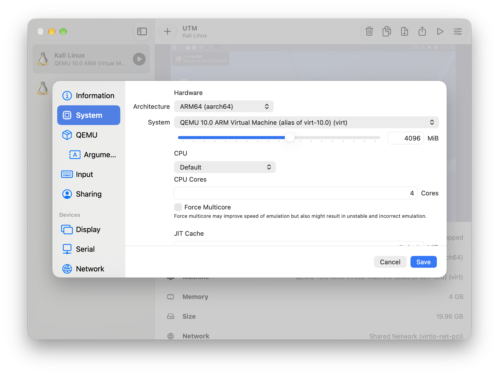
UTM System settings: ARM64, QEMU 10.0, Memory 4096 MiB, CPU 4 cores, Size 19.96 GB.

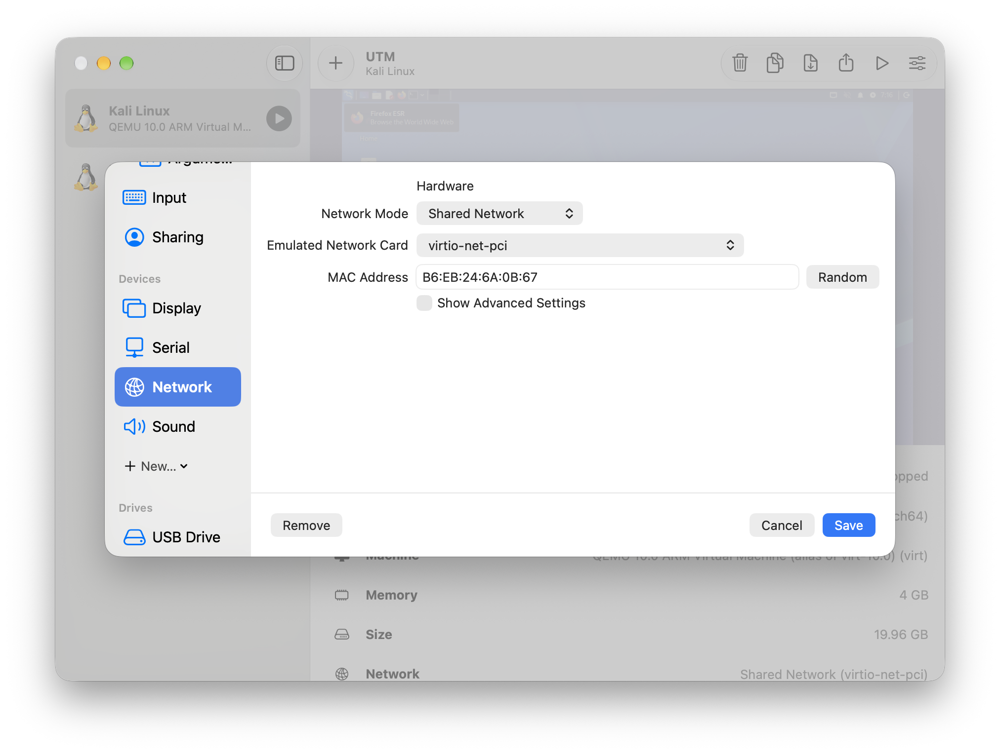
UTM Network settings: Shared Network, virtio-net-pci, MAC B6:EB:24:6A:0B:67.

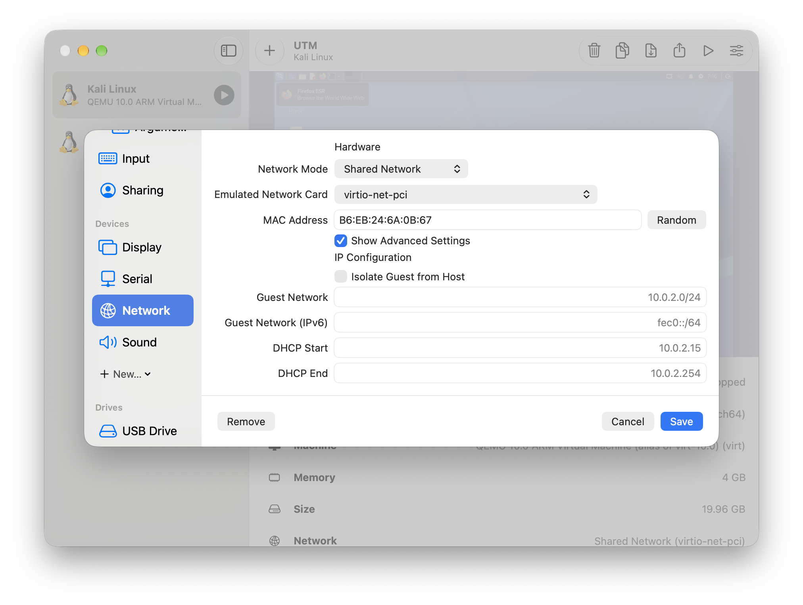
UTM Network advanced settings, before my change: Guest Network blank, placeholder 10.0.2.0/24.

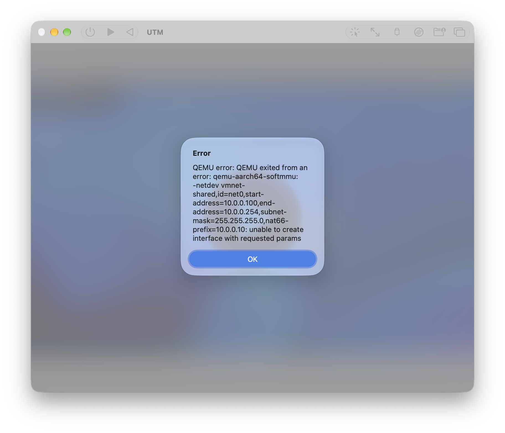
The error when I set Guest Network to 10.0.0.0/24: QEMU exited, vmnet-shared, unable to create interface with requested params.

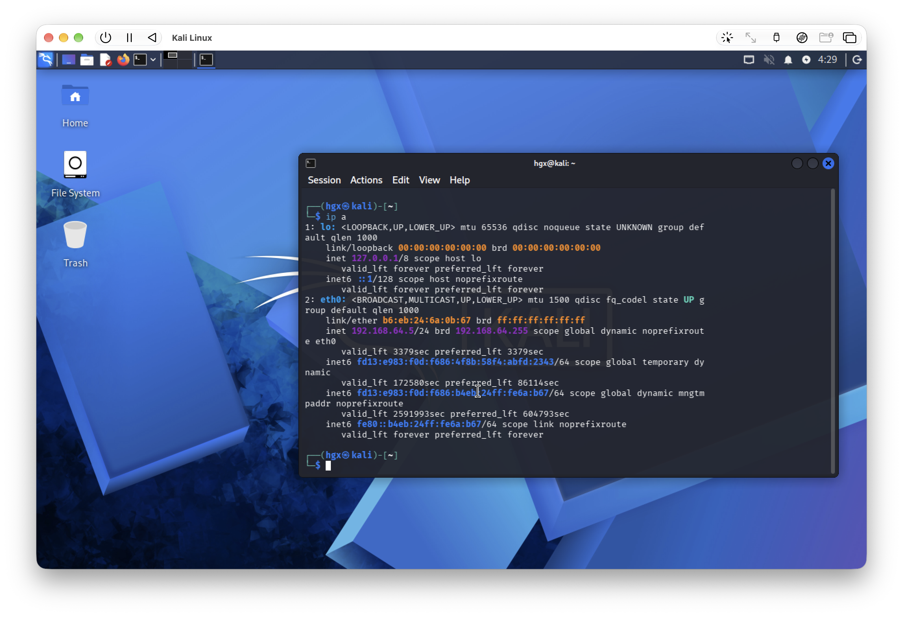
Kali desktop after login, terminal with `ip a`: eth0 inet 192.168.64.5/24.

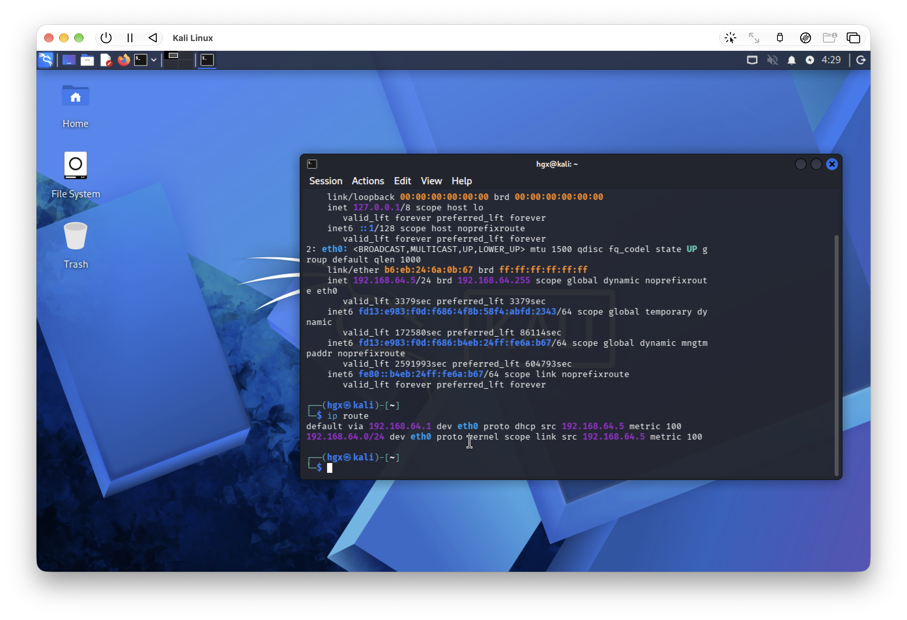
`ip route`: default via 192.168.64.1 dev eth0, src 192.168.64.5.

`ping -c 4 192.168.64.1`: 4 sent, 4 received, 0% packet loss.

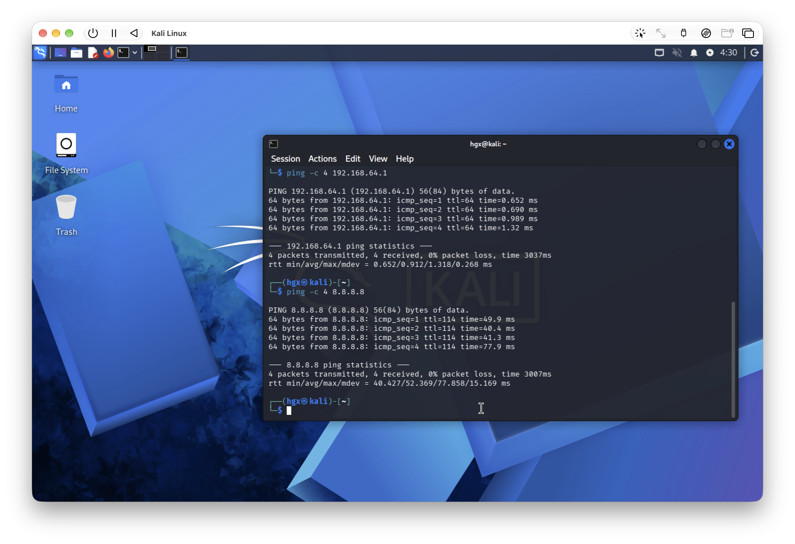
`ping -c 4 8.8.8.8`: 4 sent, 4 received, 0% packet loss, avg 52.369 ms.

`nslookup networkwalks.com`: Server 192.168.64.1, Address 192.232.216.135.

`nmap --version`: Nmap version 7.99, aarch64-unknown-linux-gnu.

After the nmcli static IP change: Connection successfully activated, `ip a` shows 192.168.64.5/24, valid_lft forever.

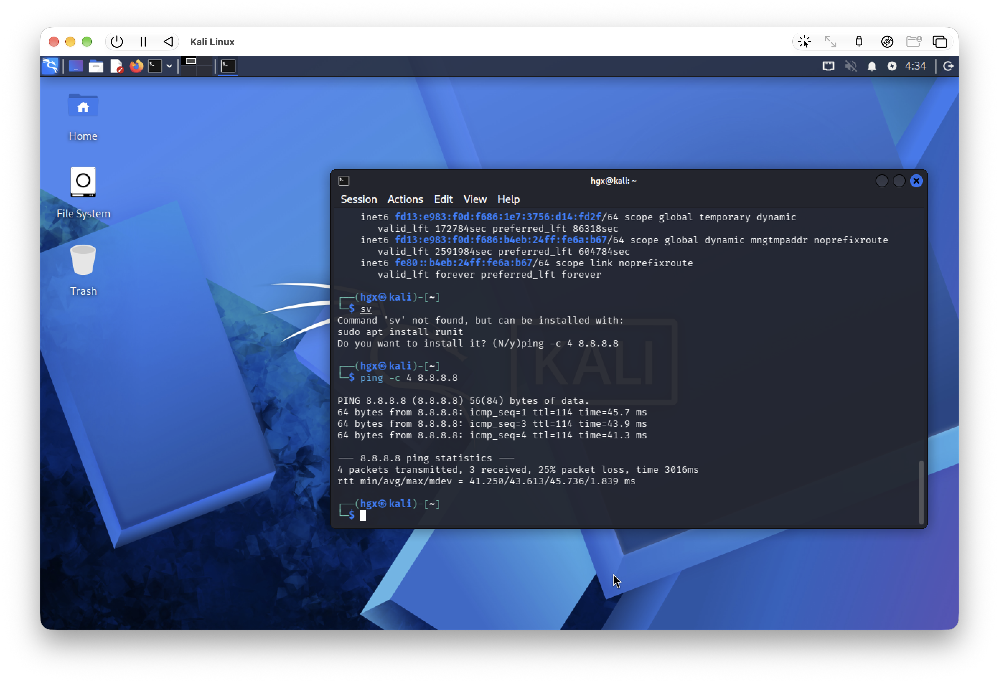
`ping -c 4 8.8.8.8` after the static IP: 4 sent, 3 received, 25% packet loss, avg 43.613 ms.

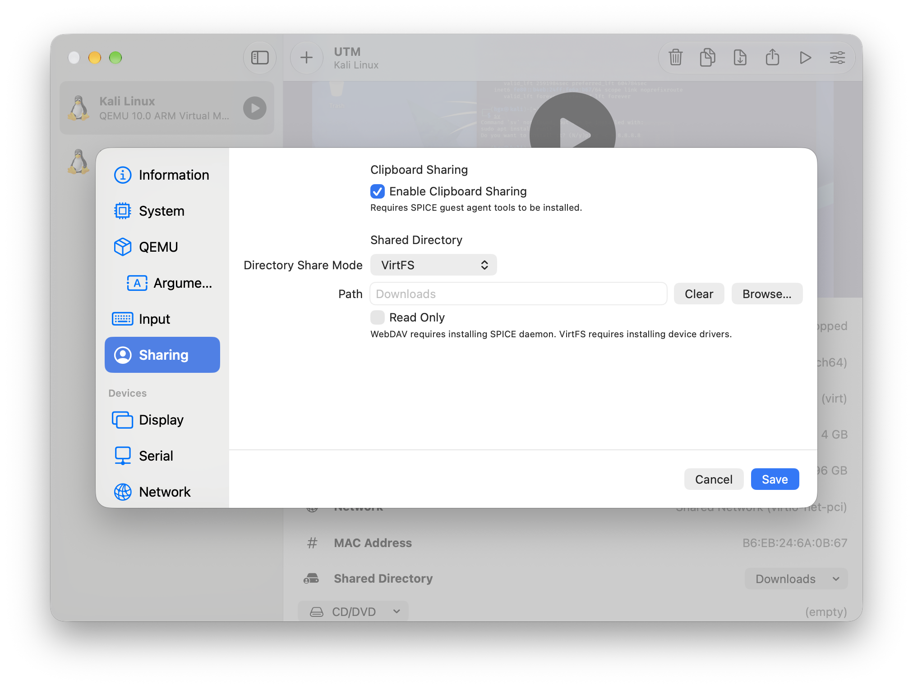
UTM Sharing: Enable Clipboard Sharing ticked, Shared Directory Path set to Downloads, Read Only unticked.

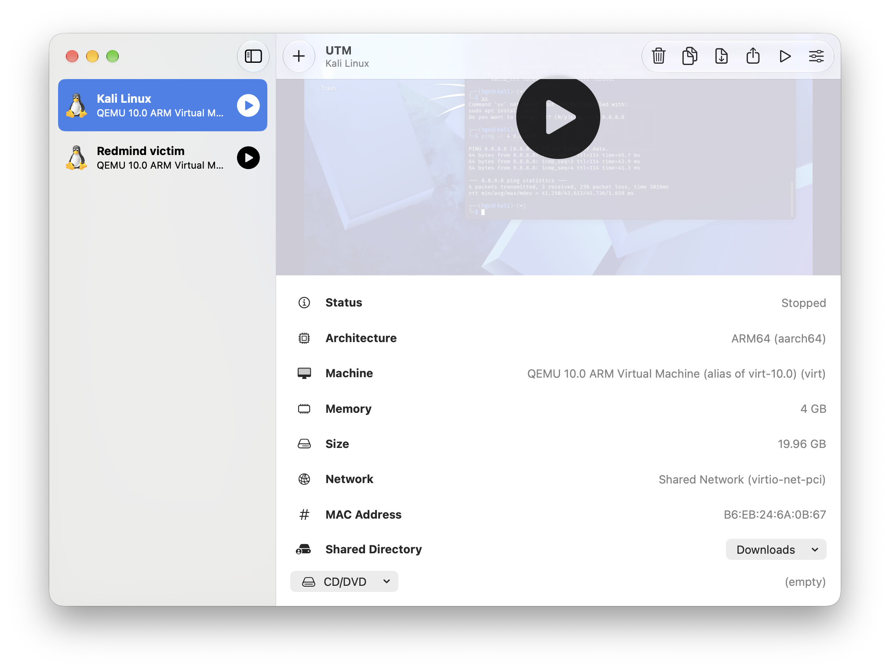
UTM main window: Kali Linux Stopped, Shared Directory Downloads, no Snapshots tab in the details view.

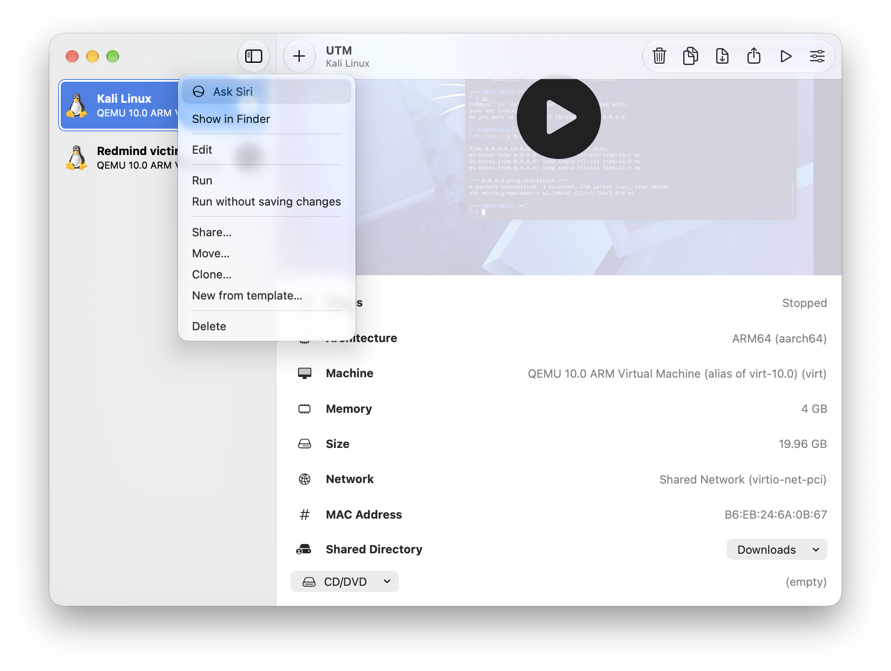
Right-click menu on the Kali VM: no Snapshots option in it.

## Problems I actually ran into

1. UTM would not take the 10.0.0.0/24 subnet. I set Guest Network to 10.0.0.0/24, DHCP Start 10.0.0.10, DHCP End 10.0.0.100, and saved. When I started Kali, QEMU exited with an error: `-netdev vmnet-shared, start-address=10.0.0.100, end-address=10.0.0.254, nat66-prefix=10.0.0.10: unable to create interface with requested params`. I checked online and this is a known UTM problem when the shared guest network is changed. What fixed it: I cleared the Guest Network, DHCP Start and DHCP End boxes back to blank and saved. Kali then booted, and DHCP gave it 192.168.64.5 on 192.168.64.0/24, gateway 192.168.64.1. I kept that subnet and made the same IP static, instead of faking a 10.0.0.2 screenshot.

2. After the static IP, one ping packet was lost. `ping -c 4 8.8.8.8` gave 3 received out of 4, 25% packet loss, avg 43.613 ms. The internet still worked, so I treated this as a one packet loss after the connection came back up, not a broken setup.

3. I could not take a snapshot in this UTM version. The Snapshots tab is not in Edit, it is not in the right-click menu, and it is not in the details view after scrolling. UTM 5 adds a Snapshots tab for QEMU VMs, my UTM does not have it. I did not update UTM before the Week 1 deadline, because the lab was working and an update could break it. Kali was shut down cleanly with `sudo poweroff`, so the state is reproducible. I will update UTM after submission and take the snapshot then.

## What I am learning

I learned that a lab plan from a task sheet does not always fit the tool on my own machine, and the honest fix is to change the plan and write down why, not to fake the expected screenshot. I also learned how to check a network step by step: IP first, then gateway, then internet, then DNS, then the tool itself. And I learned that a static IP is only real when `ip a` shows valid_lft forever after a down and up, not just when the command runs without an error.

## Rules I am following

This lab is only for learning, and only on machines I own or have permission to test. I will not point these tools at systems that are not mine.

## About this project

Program: Networkwalks Cybersecurity Internship
Batch: B084M
Week: 1
Task: WK1-PM1, lab setup, adapted to UTM on Apple Silicon
Author: Muhammad Abdul Hanan
Lab done: 6 November 2026

Links I used:
- Kali Linux: https://kali.org/get-kali
- Networkwalks project submission: https://networkwalks.com/project-submit/
